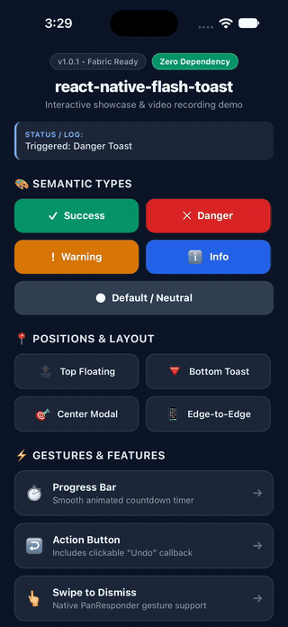
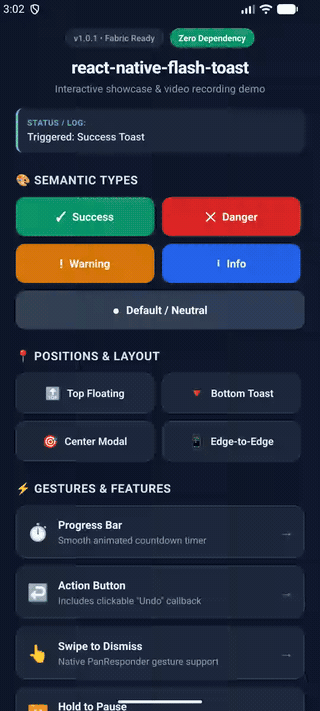

# @mehul214/react-native-flash-toast ⚡️

[](https://www.npmjs.com/package/@mehul214/react-native-flash-toast)
[](https://www.npmjs.com/package/@mehul214/react-native-flash-toast)
[](LICENSE)
[](https://www.typescriptlang.org/)
[](https://reactnative.dev)
[](CONTRIBUTING.md)
[](https://github.com/sponsors/Mehul214)
[](https://buymeacoffee.com/mehulreshac)
[](#-support-via-upi)

> Next-generation flash message, alert bar, and toast notification library for **React Native** and **Expo**. Built for the **New Architecture (Fabric)**, modern safe areas, dynamic islands, and interactive swipe-to-dismiss gestures.

A modern, drop-in replacement for the outdated `react-native-flash-message` package.

---

## 📱 Preview

<p align="center">
  <table align="center">
    <tr>
      <th align="center"><b>iOS (Dynamic Island & Swipe)</b></th>
      <th align="center"><b>Android (Edge-to-Edge)</b></th>
    </tr>
    <tr>
      <td align="center">
        <a href="https://raw.githubusercontent.com/Mehul214/react-native-flash-toast/main/assets/iOS.mp4">
          
        </a>
        <br />
        <sub><a href="https://raw.githubusercontent.com/Mehul214/react-native-flash-toast/main/assets/iOS.mp4">▶ Click to watch HD video</a></sub>
      </td>
      <td align="center">
        <a href="https://raw.githubusercontent.com/Mehul214/react-native-flash-toast/main/assets/Android.webm">
          
        </a>
        <br />
        <sub><a href="https://raw.githubusercontent.com/Mehul214/react-native-flash-toast/main/assets/Android.webm">▶ Click to watch HD video</a></sub>
      </td>
    </tr>
  </table>
</p>

---

## 🌟 Why react-native-flash-toast?

| Feature | `react-native-flash-message` (Legacy) | `react-native-flash-toast` (This Package) |
| :--- | :---: | :---: |
| **New Architecture (Fabric)** | ⚠️ Deprecated / Layout warnings | ✅ **100% Native Driver & Fabric Ready** |
| **Edge-to-Edge / Dynamic Island** | ❌ Hardcoded iPhone X dimensions | ✅ **Auto-adaptive safe-area insets** |
| **Gestures** | ❌ No swipe gesture dismissal | ✅ **Smooth swipe-up / swipe-down to dismiss** |
| **Countdown Timer Progress Bar** | ❌ None | ✅ **Built-in animated progress bar** |
| **Pause on Press** | ❌ None | ✅ **Pauses autoHide timer while held** |
| **Action Buttons** | ❌ Manual boilerplate | ✅ **Native Action Buttons (Undo, Retry)** |
| **React Hooks** | ❌ Global ref only | ✅ **Both `useFlashMessage()` hook & global `showMessage()`** |
| **Zero Native Dependencies** | ✅ Pure JS/TS | ✅ **Pure JS/TS (Works in Expo Go instantly)** |

---

## 📦 Installation

```bash
npm install @mehul214/react-native-flash-toast
# or
yarn add @mehul214/react-native-flash-toast
# or
pnpm add @mehul214/react-native-flash-toast
```

*(No `pod install` or native linking required!)*

---

## 🚀 Quick Start

### 1. Mount the Container

Add `<FlashMessage />` at the root of your application (typically in `App.tsx` or your root layout component):

```tsx
import React from 'react';
import { View } from 'react-native';
import { FlashMessage } from '@mehul214/react-native-flash-toast';

export default function App() {
  return (
    <View style={{ flex: 1 }}>
      <YourAppNavigator />
      {/* Place at the very end so it renders above everything */}
      <FlashMessage position="top" />
    </View>
  );
}
```

### 2. Trigger from Anywhere!

Call `showMessage` anywhere in your code — inside components, hooks, navigation listeners, Redux sagas, Zustand stores, or API error interceptors:

```tsx
import { showMessage, hideMessage } from '@mehul214/react-native-flash-toast';

// Simple success message
showMessage({
  message: 'Payment Successful!',
  description: 'Your subscription is now active.',
  type: 'success',
});

// Danger / Error alert
showMessage({
  message: 'Failed to upload image',
  description: 'Please check your internet connection.',
  type: 'danger',
});

// Bottom toast with action button & progress bar
showMessage({
  message: 'Item moved to Archive',
  type: 'default',
  position: 'bottom',
  showProgressBar: true,
  action: {
    label: 'Undo',
    onPress: () => console.log('Undoing action...'),
  },
});
```

---

## 🪝 React Hook Usage

Prefer modern React hooks? Wrap your app with `<FlashMessageProvider>`:

```tsx
import { FlashMessageProvider, useFlashMessage } from '@mehul214/react-native-flash-toast';

function Root() {
  return (
    <FlashMessageProvider position="top">
      <App />
    </FlashMessageProvider>
  );
}

function ProfileScreen() {
  const { show, hide } = useFlashMessage();

  return (
    <Button
      title="Save"
      onPress={() =>
        show({
          message: 'Saved!',
          type: 'success',
        })
      }
    />
  );
}
```

---

## 🎨 Semantic Types & Built-in Themes

| Type | Default Background | Default Icon | Intended Use |
| :--- | :--- | :--- | :--- |
| `success` | `#059669` (Emerald) | Checkmark | Confirmed actions, saved states |
| `danger` / `error` | `#DC2626` (Red) | Cross (X) | Errors, network failures |
| `warning` | `#D97706` (Amber) | Exclamation (!) | Disconnections, low storage |
| `info` | `#2563EB` (Blue) | Info (i) | Informational alerts, updates |
| `default` | `#1F2937` (Dark Slate) | Bullet | Neutral toasts & notifications |

---

## 🌈 Full Color & Icon Customization (v1.1.0)

Every flash message can be fully customized with bespoke colors, borders, badges, and icons:

### 1. Custom Colors & Borders per Toast

```tsx
showMessage({
  message: 'Payment Received!',
  description: 'Your invoice #4829 has been settled.',
  backgroundColor: '#4F46E5', // Custom Indigo card background
  color: '#EEF2FF',           // Title color
  descriptionColor: '#C7D2FE',// Subtitle color
  icon: 'star',               // Built-in star icon
  iconColor: '#FBBF24',       // Golden icon
  iconBadgeColor: 'rgba(251, 191, 36, 0.25)', // Custom badge glow
  borderRadius: 20,           // Custom pill curvature
  borderColor: '#818CF8',     // Outline border
  borderWidth: 1.5,
  showProgressBar: true,
  progressBarColor: '#A5B4FC',// Custom progress bar fill
  progressBarBackgroundColor: 'rgba(255, 255, 255, 0.15)',
});
```

### 2. Built-in Vector Icon Presets

Zero external vector libraries needed! All icons render pixel-perfect on iOS, Android, and Web:

* `'success'` / `'check'` — Crisp geometric checkmark
* `'danger'` / `'error'` — Bold X cross
* `'warning'` — Exclamation mark
* `'info'` — Clean modern info mark (no double-circle)
* `'bell'` — Notification bell
* `'star'` — 4-point sparkle star
* `'heart'` — Geometric heart
* `'lock'` — Security padlock
* `'loading'` — Smooth animated spinning indicator
* `'default'` — Centered bullet dot

```tsx
// Animated loading toast
showMessage({
  message: 'Uploading photos...',
  description: 'Please wait while we sync your files.',
  icon: 'loading', // Animated spinning indicator
  autoHide: false,
});
```

### 3. Advanced Icon Configuration Object

Customize the icon size, badge background, position, or render your own icon library (e.g. Lucide, Ionicons, FontAwesome):

```tsx
showMessage({
  message: 'New Notification',
  icon: {
    name: 'bell',
    color: '#F59E0B',
    size: 20,
    badge: true,                    // Circular badge background (set false for flat icon)
    badgeColor: 'rgba(245, 158, 11, 0.2)',
    position: 'right',              // Place icon on 'left' or 'right' of text
  },
});
```

### 4. Global Custom Themes

Register custom brand themes once and use them across your entire app:

```tsx
import { setColorTheme } from '@mehul214/react-native-flash-toast';

// Register your brand theme
setColorTheme('brand', {
  background: '#7C3AED',
  text: '#FFFFFF',
  icon: '#DDD6FE',
  iconBadge: 'rgba(255, 255, 255, 0.2)',
  description: '#EDE9FE',
});

// Trigger anywhere with type: 'brand'
showMessage({
  message: 'Welcome to Pro!',
  type: 'brand',
});
```

---

## ⚙️ Options & API Reference

| Option | Type | Default | Description |
| :--- | :--- | :--- | :--- |
| `message` | `string \| ReactNode` | **Required** | The main title or text content |
| `description` | `string \| ReactNode` | `undefined` | Secondary subtitle or detailed message |
| `type` | `'default' \| 'success' \| 'danger' \| 'warning' \| 'info' \| string` | `'default'` | Semantic color preset or registered custom theme |
| `position` | `'top' \| 'bottom' \| 'center'` | `'top'` | Screen anchor position |
| `duration` | `number` | `3000` | Auto-dismiss duration in ms (0 to disable) |
| `autoHide` | `boolean` | `true` | Automatically dismiss after duration |
| `floating` | `boolean` | `true` | Modern rounded floating card vs edge-to-edge |
| `swipeToDismiss` | `boolean` | `true` | Swipe gesture to dismiss |
| `pauseOnPress` | `boolean` | `true` | Pauses countdown timer while finger holds card |
| `showProgressBar`| `boolean` | `false` | Displays visual countdown progress indicator |
| `action` | `{ label, onPress, style?, textStyle? }` | `undefined` | Action button (e.g. Undo, Retry) |
| **`icon`** | `BuiltInIconType \| ReactNode \| Function \| IconConfigObject` | Semantic type | Built-in preset name, JSX, render func, or config object |
| **`iconColor`** | `string` | Text color | Independent icon color |
| **`iconSize`** | `number` | `18` | Size of icon in pixels |
| **`iconBadge`** | `boolean` | `true` | Toggle circular backdrop badge behind icon |
| **`iconBadgeColor`** | `string` | Translucent white | Custom background color of the icon badge |
| **`iconPosition`** | `'left' \| 'right'` | `'left'` | Display icon on the left or right of text |
| **`backgroundColor`**| `string` | Preset background | Override card background color |
| **`color`** | `string` | Preset text color | Override title text color |
| **`descriptionColor`**| `string` | `rgba(255,255,255,0.9)` | Override subtitle text color |
| **`borderColor`** | `string` | `undefined` | Custom card outline border color |
| **`borderWidth`** | `number` | `undefined` | Custom card outline border width |
| **`borderRadius`**| `number` | `16` (floating) | Custom card corner curvature |
| **`progressBarColor`**| `string` | White | Custom color of progress bar fill |
| **`progressBarBackgroundColor`**| `string` | Translucent | Custom track background of progress bar |
| `onPress` | `() => void` | `undefined` | Callback on banner tap |
| `onShow` | `() => void` | `undefined` | Callback when message enters view |
| `onHide` | `() => void` | `undefined` | Callback after message finishes exit |
| `customComponent`| `(options, hide) => ReactNode` | `undefined` | Completely replace the inner card layout |

---

## 🔄 Migrating from `react-native-flash-message`

Migrating is 100% drop-in compatible! Simply change the import:

```diff
- import FlashMessage, { showMessage, hideMessage } from "react-native-flash-message";
+ import FlashMessage, { showMessage, hideMessage } from "@mehul214/react-native-flash-toast";
```

Your existing `showMessage({ message, description, type, ... })` calls will work immediately, but with:
- No more New Architecture Fabric warnings
- Native iOS & Android edge-to-edge support
- Modern fluid spring animations & swipe gestures

---

## 💖 Support the Project & Sponsoring

Building and maintaining open-source libraries takes dedicated effort. If `react-native-flash-toast` helps you build great React Native applications or saves your team time, please consider supporting development:

- ⭐️ **Star the repository on GitHub** (helps more developers discover it)
- 💖 **[Sponsor on GitHub Sponsors](https://github.com/sponsors/Mehul214)**
- ☕️ **[Buy Me a Coffee](https://buymeacoffee.com/mehulreshac)**

<p align="left">
  <a href="https://buymeacoffee.com/mehulreshac" target="_blank">
    
  </a>
</p>

### ☕️ Support via UPI

If you're in India or use any UPI-enabled payment app (Google Pay, PhonePe, Paytm, BHIM, Cred, Amazon Pay):

- **UPI ID:** `mehulreshamwala7@okhdfcbank`
- **Payee Name:** Mehul Reshamwala

<p align="left">
  <a href="upi://pay?pa=mehulreshamwala7@okhdfcbank&pn=Mehul%20Reshamwala&cu=INR&tn=Support%20react-native-flash-toast">
    
  </a>
  <br />
  <sub>Scan with Google Pay / PhonePe / Paytm or <a href="upi://pay?pa=mehulreshamwala7@okhdfcbank&pn=Mehul%20Reshamwala&cu=INR&tn=Support%20react-native-flash-toast">tap here on mobile to pay directly</a>.</sub>
</p>

---

## 🤝 Contributing

Contributions, feature requests, and bug reports are welcome! Please check the [Contributing Guide](CONTRIBUTING.md).

## 📄 License

MIT © 2026 Mehul. Free for personal and commercial use.

